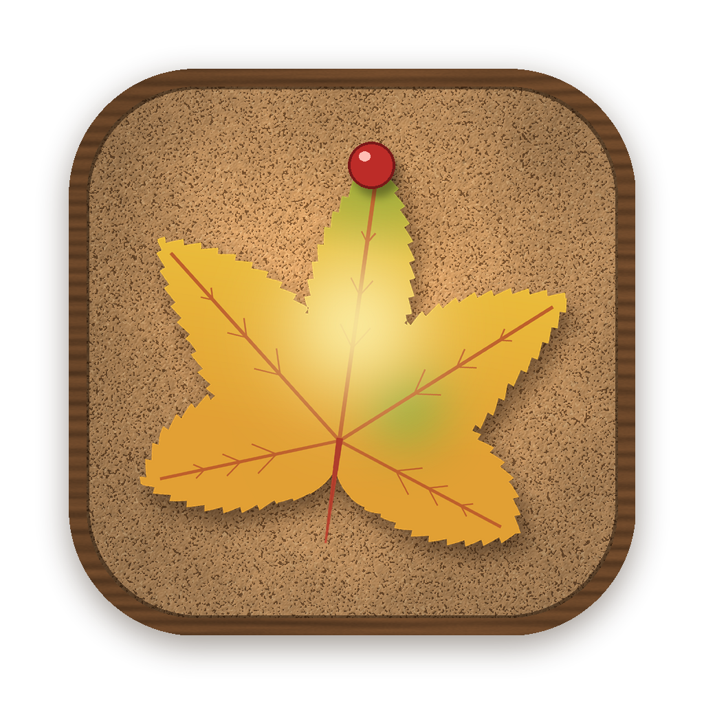
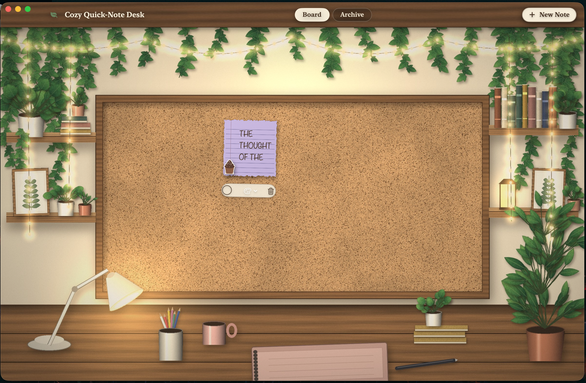
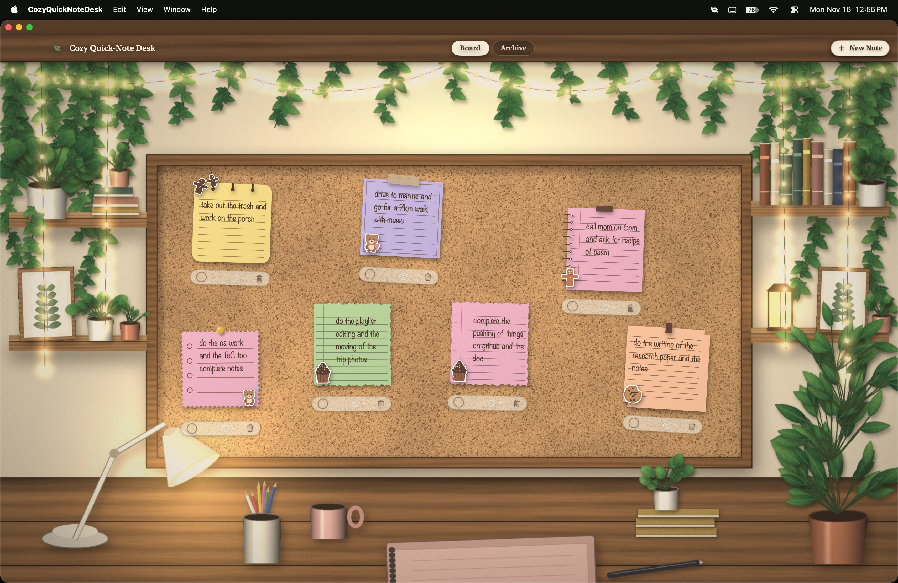
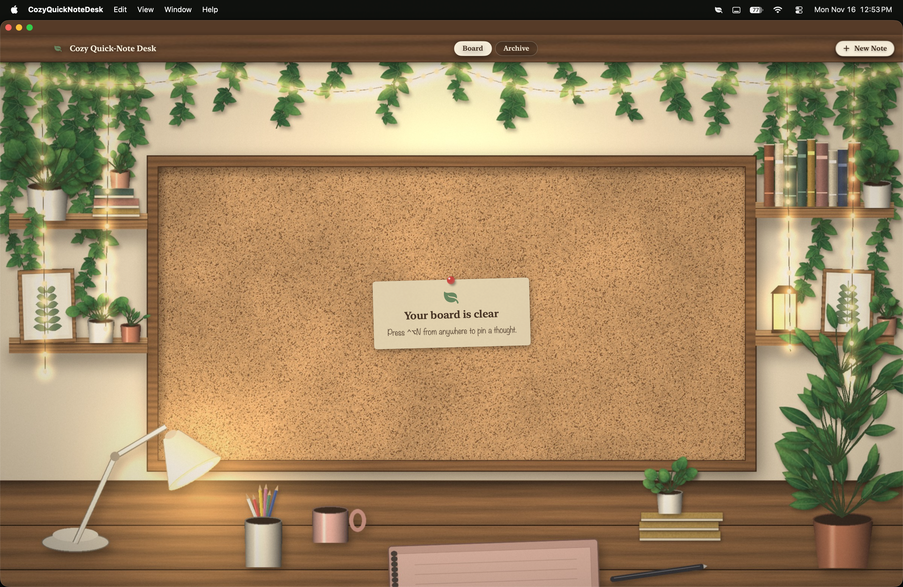
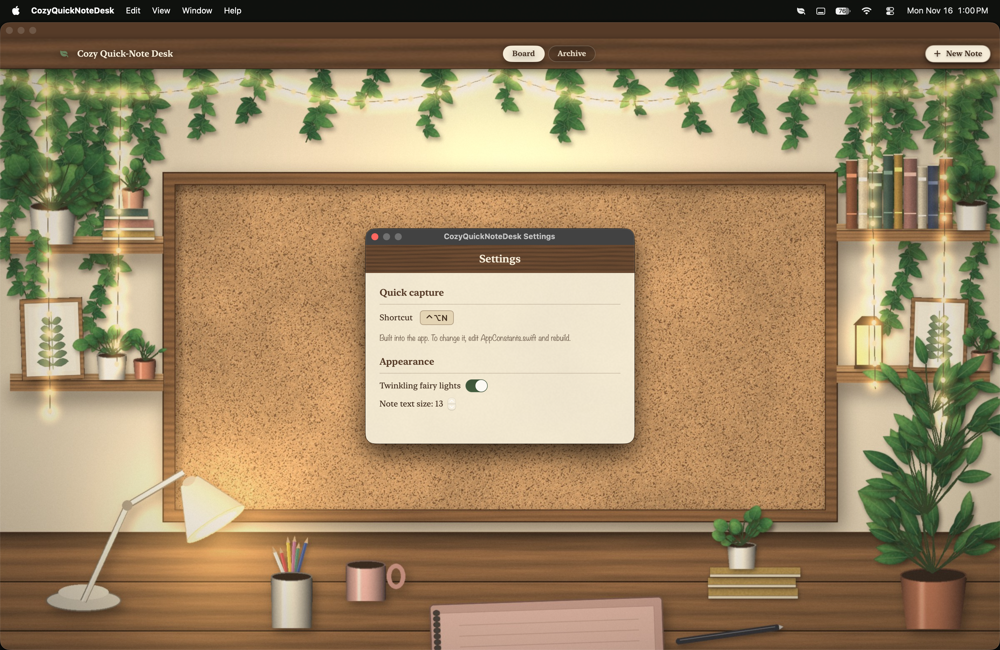
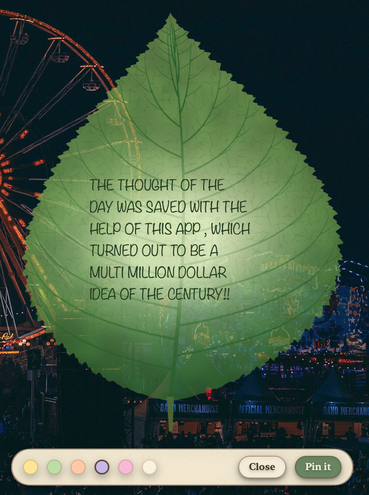
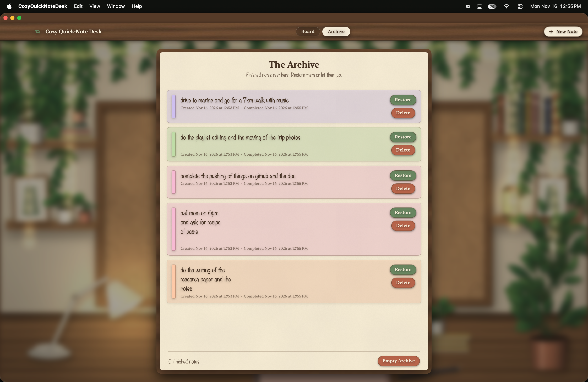
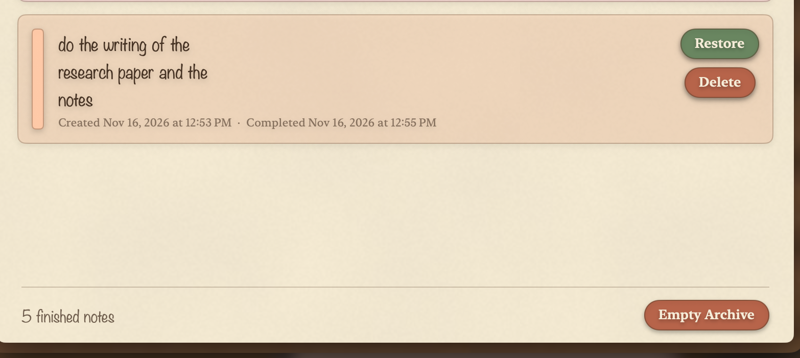

<p align="center"></p>

# 🍃 Cozy Quick-Note Desk

A native macOS app that turns your thoughts into sticky notes pinned on a cork board, in a warm, softly lit **virtual study room**. Wooden desk, ivy, shelves of books, a glowing lamp and twinkling fairy lights. Every screen belongs to the same room.

> Press a shortcut from anywhere → a translucent **leaf** floats up → write your thought → it's pinned on your board. Tick the circle when it's done and it fades into the Archive.

**Capture instantly · save automatically · organize naturally · complete peacefully.**


## Screenshots

### The Study Room

The cozy workspace, featuring a cork board, customizable sticky notes, and appearance settings.









### Quick Capture

Capture thoughts instantly using the floating translucent leaf interface.



### Archive

Completed notes are stored in the archive, where they can be restored or permanently deleted.






## Download (no Terminal needed)

1. Open the [**Releases**](https://github.com/Jenil-2711/QuickNote_app/releases/latest) page and download `CozyQuickNoteDesk-<version>.dmg`.
2. Open the disk image and drag **Cozy Quick-Note Desk** into **Applications**.
3. Open it from Launchpad or Spotlight. A leaf appears in the menu bar and the shortcut works from any app.

Works on macOS 13 or later, on both Apple Silicon and Intel Macs.

**First launch:** the app is free and open source but not notarized by Apple (that needs a paid developer account), so macOS may say it "can't be opened". This is normal for indie apps. Do this once:
1. Try to open the app. macOS says it can't be opened. Click **Done**.
2. Open **System Settings → Privacy & Security**, scroll down to the message about *Cozy Quick-Note Desk*, click **Open Anyway** and confirm with your password or Touch ID. (On macOS 13 and 14 you can instead right-click the app and choose **Open**.)
3. Still blocked? Run `xattr -dr com.apple.quarantine "/Applications/Cozy Quick-Note Desk.app"` in Terminal.

Prefer to build it yourself? Clone the repo and run `./scripts/build_app.sh --install`.

## Features
- 🍂 **Leaf quick-capture**: global shortcut (default **⌃⌥N**, changeable in Settings) opens a transparent leaf to type on. `⌘↩` pins it, `Esc` leaves the text box, `Esc` again closes. Your draft is autosaved.
- 📌 **Cork board of sticky notes** in eight cozy stationery designs (spiral notebook, taped page, ring binder, perforated checklist with a chocolate bow, torn paper and more), decorated with little bear, gingerbread, cookie and cupcake stickers. Each new note gets one at random, in your choice of pastel colour, placed naturally on the board, tilted ±4° and draggable. Positions and tilt are remembered.
- 🌿 **One cohesive room**: the board, the Archive (index cards in a wooden frame), Settings and the leaf popup all share the same wood, paper and warm-light look.
- ✨ **Fairy lights** gently twinkle over the real bulbs in the room.
- ✅ **Peaceful completion**: circular checkbox, green tick, gentle fade, then into the Archive. Restore or delete permanently from there.
- 💾 **Safe storage**: one JSON file, atomic writes, damaged files set aside (never deleted).
- 🔒 **Private**: no accounts, no cloud, no network.
- 🧭 Menu bar icon keeps the shortcut alive after you close the main window.
- 🌙 **Runs silently**: starts quietly at login (optional), shows no Dock icon while you use the shortcut, and appears in the Dock only while the study-room window is open. A real quit is in the menu bar (Quit Completely).

## Requirements
macOS 13+, Xcode 15+ (or the Swift 5.9+ toolchain).

## Run
```bash
git clone https://github.com/Jenil-2711/QuickNote_app.git
cd QuickNote_app
swift run
```
Open the folder in **VS Code** with the Swift extension (`swiftlang.swift-vscode`) or open `Package.swift` in Xcode.

```bash
swift test                 # unit tests (storage, damaged file, failing disk, quit-while-typing…)
./scripts/build_app.sh     # builds dist/Cozy Quick-Note Desk.app
```

## Project layout
```
Package.swift
Sources/CozyQuickNoteDesk/
  App/            entry point, app delegate, constants
  Models/         Note, NoteColor, NoteDesign (the 8 designs), NotePlacement
  Storage/        JSONNoteStore (atomic, damage-safe)
  Managers/       NoteManager (the app's "brain")
  QuickCapture/   global hotkey, transparent leaf panel and view, draft autosave
  Theme/          palette, fonts, wood and paper surfaces, push-pin, buttons
  Views/
    Room/         room background, twinkling lights, board layout constants
    Board/        cork board screen, sticky notes and their shapes
    Archive/      index-card archive
    Settings/     settings sheet
    Shared/       resource loading
  Resources/      room.jpg, wood.jpg, paper.jpg, leaf.png, note_*_paper.png / note_*_deco.png
Tests/            XCTest suites
scripts/          generate_assets.py, studio_lib.py, generate_notes.py, generate_leaf.py, build_app.sh
docs/             DESIGN.md
```

## About the artwork
There are **no photographs** in this repository. The room, wood, cork, paper, sticky notes and leaf are rendered by the Python scripts in `scripts/`, so they can be changed and reproduced. The one exception is the **app icon**, which was created with an AI image tool (Gemini) and then cut out and placed on Apple's icon grid by `scripts/prepare_icon.py` (the earlier cork-and-leaf icon is still drawn by `scripts/generate_icon.py`). To regenerate the code-drawn artwork:

```bash
pip install pillow numpy
python3 scripts/generate_assets.py   # room.jpg, wood.jpg, paper.jpg + layout constants
python3 scripts/generate_leaf.py     # leaf.png
python3 scripts/generate_notes.py    # the 8 sticky-note designs
```
Want a different mood? Edit the colours and object positions in `scripts/generate_assets.py` and re-run it. The cork-board position and light positions are exported to Swift automatically.

## Customising
- **Shortcut:** change it in Settings (⌘,): click the shortcut, then press the keys you want.
- **Palette and fonts:** `Theme/Theme.swift`.
- **Room:** `scripts/generate_assets.py`.
- **Note designs:** `scripts/generate_notes.py` (paper layout, stickers, and where text may be written).

## Roadmap
- [x] Foundation, note engine, autosave
- [x] Quick capture (leaf), menu bar, shortcut
- [x] Virtual study room, cork board, shaped notes, dragging
- [x] Completion, archive, restore
- [ ] Final polish, app icon, release build

## Project history

This project keeps improving. Every change, bug and lesson is written up in [`improvements/`](improvements/).

## Contributing

Ideas and bug reports are welcome. See [CONTRIBUTING.md](CONTRIBUTING.md); the history of every change is in [`improvements/`](improvements/).

## License
MIT
